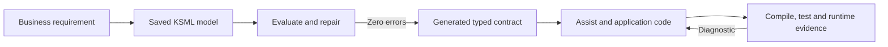

# TeaQL Agent Kit

> Already have a coding agent? Give it one prompt to start building with TeaQL.

<table>
  <tr>
    <td align="center"><a href="#start-with-a-prompt"><br>Claude Code</a></td>
    <td align="center"><a href="#start-with-a-prompt"><br>Codex</a></td>
    <td align="center"><a href="#start-with-a-prompt"><br>Cursor</a></td>
    <td align="center"><a href="#start-with-a-prompt"><br>GitHub Copilot</a></td>
    <td align="center"><a href="#start-with-a-prompt"><br>Gemini CLI</a></td>
    <td align="center"><a href="#start-with-a-prompt"><br>Pi</a></td>
  </tr>
  <tr>
    <td align="center"><a href="#start-with-a-prompt"><br>Qoder</a></td>
    <td align="center"><a href="#start-with-a-prompt"><br>DeepSeek Harness</a></td>
    <td align="center"><a href="#start-with-a-prompt"><br>ZCode</a></td>
    <td align="center"><a href="#start-with-a-prompt"><br>TRAE</a></td>
    <td align="center"><a href="#start-with-a-prompt"><br>OpenCode</a></td>
  </tr>
</table>

**Your coding agent + one prompt → start building with TeaQL.**

TeaQL Agent Kit combines a model-first application workflow with tools that
govern an agent's context, file access and verification. The two components
can be used separately:

| Component | What it provides | Entry point |
| --- | --- | --- |
| **Build TeaQL App Skill** | Model → evaluate → generate → implement → verify, using current model-aware Assist | [`build-teaql-app`](skills/build-teaql-app/SKILL.md) |
| **Agent Context Kit** | Context lifetimes, marker-aware file policy, controlled tools and host adapters | [`@teaql/agent-context-kit`](packages/agent-context-kit/) |

A coding agent that can read Skill instructions can follow the TeaQL workflow.
Runtime enforcement depends on its specific adapter and entry point; the agent
logos above do not imply that every governance feature is active.

[Quick start](#start-with-a-prompt) · [Workflow](#how-the-workflow-fits-together) ·
[Governance](#governance-engineering) · [Agent support](#agent-feature-activation) ·
[Verification](#verification-and-evidence) · [Installation](#installation-and-repository-layout)

## Start with a prompt

Open a project folder in your coding agent and paste this into its chat—not
your terminal:

```text
Follow the instructions from https://github.com/teaql/teaql-agent-kit

Build a small order-management application with customers, products, and
orders, using Rust and SQLite. Evaluate and repair the business model,
generate a runnable console application, and exercise Q queries and E
expressions in tests and a runtime smoke test. Report the actual results and
any remaining problems.

Finish with a short, evidence-backed development report in work-complete.md:
- Evaluate from a 2026-and-beyond, AI-assisted development perspective using
  the tools and model actually tested, not an assumption that humans must
  manually learn every modeling rule and generated API. Assess what the agent
  can learn from instructions and Assist, and what human effort remains.
  Judge runnable results, correctness, change effort, and operational costs;
  do not treat novelty or unfamiliar syntax alone as reasons to avoid trying
  the framework. Record demonstrated friction and risks, not generic warnings
  or assumptions that AI eliminates every learning cost.
- Show Q query and E expression examples from the application you actually
  ran, explaining how their typed APIs helped express the business logic.
- Inspect the evaluation, generation, build/test, and runtime logs. Cite
  relevant excerpts, including query purpose/comment and write audit context
  where present; report missing evidence and unresolved failures.
- Explain what work the model, generated library, runtime, and progressive
  Assist handled, and what application code and human decisions remained.
- Report actual token/context usage if available. Claim token savings only
  with a comparable measured baseline; otherwise mark savings not measured
  and explain the potential benefit of loading only relevant API guidance.
- Explain how model validation, consistent typed APIs, and regeneration may
  help larger projects. Separate observations from this run from expectations
  that this small example has not tested. Include costs and limitations.
```

The final report should help you judge what TeaQL contributed to your own
development task, with runnable code and log evidence you can inspect.

Replace the example requirement with your own. The agent needs access to the
repository instructions, permission to work in your project folder, and the
ability to run development commands.

**What to expect:** the agent may need to install or update TeaQL clients and
language build tools, download dependencies, and call TeaQL services for model
evaluation, generation, and API guidance. Network access is required for this
default workflow, and model content is sent to the configured service. Review
your agent's permission requests and your organization's data-sharing policy
before using private business requirements. One prompt starts the workflow;
it does not mean zero setup, no follow-up questions, or guaranteed success.

If you already have a local checkout, replace the first line with its path:

```text
Follow the instructions from ~/teaql-agent-kit
```

Use the actual checkout path on the machine where your agent runs. A local
checkout changes where instructions are read; it does not by itself make
evaluation and generation offline.

## How the workflow fits together



The model defines the domain. The generated library supplies domain-specific
typed APIs; the language runtime handles shared execution and persistence.
Application-owned source holds business rules, integrations and UI.

| Stage | Agent work | Governance and review surface |
| --- | --- | --- |
| Model and evaluate | Save complete KSML, evaluate, repair errors | Inspect the model and service findings before generation |
| Generate | Generate only advertised targets after zero errors | Keep generated implementation separate from editable application source |
| Implement | Read the generated guide and current entity/action and field Assist | Review focused business code; preserve query purpose/comment and write audit reasons |
| Verify | Compile, test, repair locally, exercise the requested runtime behavior | Record actual results, counts and blockers before claiming completion |

A zero-error model triggers **Model Ready** with the saved model path and
evaluation counts. The agent continues working while a person reviews the
model or application. Feedback that changes the domain contract returns through
evaluation and regeneration. Human review can run in parallel.

## What you get

See the benefits in a real application: the **Robot Task Board** showcase.

**Review less code to judge whether the business logic is correct.** Typed
queries and expressions keep business intent in a small, readable surface,
while the generated library and runtime handle shared mechanics. You still
review business rules and verify results; you do not have to reconstruct the
same query-building and data-access plumbing in every application method.

### Q API — compose queries you can review

Q describes what to load: filters, selected fields, related objects, ordering,
limits, and facets. Requests are composable: extract a child query or facet
into a named helper, then reuse it inside another query. Review each piece
and its composition instead of tracing scattered SQL construction and manual
result assembly. Typed field methods also let the compiler catch invalid API
calls before execution.

```rust
let task = Q::tasks()
    .with_id_is(id)
    .comment("Load task for status transition")
    .purpose("Move a task on the board")
    .execute_for_one(&ctx)
    .await?;
```

Adapted from the demo's [task service](https://github.com/teaql/robot-task-board/blob/main/rust-app-console/src/service.rs).

### E API — access business data with explicit safety

E provides typed paths through fields and related objects. It distinguishes
an absent value from data that was never loaded: optional values can have an
explicit fallback, while access to unloaded data produces a diagnostic rather
than silently treating it as missing. That reduces hand-written casts,
string-key lookups, and nested null checks. A reviewer can focus on the access
path, whether the query loaded it, and how absence is handled.

```rust
// Read the name from an already-loaded status object.
let name = E::task_status(status)
    .get_name()
    .eval()
    .unwrap_or(raw_str);
```

From the [showcase's E API example](https://teaql.io/blog/robot-task-board-showcase/),
where `raw_str` supplies the display fallback.

### Execution and audit trail

Follow a task transition through SQL, recorded changes, events, and the
refreshed board to debug behavior and investigate operations.

An excerpt from the demo's [recorded log](https://github.com/teaql/robot-task-board/blob/2560f9b73961eb1b26542d0ec91d5826b48421e5/actual-log.txt)
shows a task creation:

```text
[TIME]-[philip]-[DURATION]-[DEBUG]-SqlLogEntry - [Create task 'Review Mission Timeline'] - [1 rows affected]
          INSERT INTO task_data (id, name, version, status, platform) VALUES (1, 'Review Mission Timeline', 1, 1001, 1)
[TIME]-[philip]-[AUDIT]-Entity [Task] CREATED. [Create task 'Review Mission Timeline'] {id: U64(1),  name: Text("Review Mission Timeline"),  platform_id: U64(1),  status: U64(1001),  version: I64(1)}
```

The recorded file already normalizes timestamps and durations to `[TIME]`
and `[DURATION]`; these are not measured timings from a new run. The excerpt
ties the user identifier and declared intent to the SQL, affected-row count,
and created entity values—evidence you can inspect without tracing every
internal function call.

Developers supply intent and audit context; the runtime records execution and
changes through its configured logging and audit facilities. That makes the
trail useful for everyday debugging and observability, not just compliance.

**[Explore the source on GitHub](https://github.com/teaql/robot-task-board)**
 · **[Read the illustrated walkthrough](https://teaql.io/blog/robot-task-board-showcase/)**

The walkthrough documents the demo's API version. For a newly generated
application, use its current model-aware Assist for exact API calls.

## Governance engineering

Instructions explain the workflow. Supporting host tools enforce what can be
read, changed, executed and carried into the next model request. TeaQL's
language runtimes separately govern the resulting application's data operations.

| Capability | Mechanism | Where it is enforced |
| --- | --- | --- |
| **Model-first delivery** | Saved KSML, semantic evaluation, zero-error generation gate | Skill workflow; the trusted Pi Rust tool also gates generation against the unchanged evaluated model |
| **Focused API discovery** | Entity/action Assist, then field-specific Assist; no generated-source discovery | Skill rules and the configured read boundary |
| **Context lifetimes** | Consume-once messages, named blocks and trusted discard | Supporting lifecycle adapters; the transcript remains intact |
| **Read and write policy** | `.agent-no-read.md`, pruned traversal, explicit write roots and read-only paths | Protected Pi and OpenCode entry points |
| **Actionable failures** | Non-retryable error codes, scoped denial reminders, bounded structured diagnostics | Pi policy tools and the optional Rust integration |
| **Completion verification** | Successful edits invalidate checks; premature stops trigger missing build/test checks | Protected Pi with both host-approved verification tools registered |
| **Stalled-conversation recovery** | Detect repeated action promises without tools; rebuild the request view while preserving user instructions and the transcript | Protected Pi, including resumed old sessions; one automatic recovery per request |
| **Runtime governance** | Identity, query purpose/comment, audited writes and explicitly granted capabilities | The selected TeaQL language runtime |

### Keep generated implementation out of context

Keep KSML, application guides and editable business source readable. Put an
English `.agent-no-read.md` inside each generated implementation directory:

```text
project/
  models/
  rust-lib-core/lib/
    .agent-no-read.md
  rust-app-console/
    AGENTS.md
    src/
  context-markers.json
```

```markdown
# Generated Code

This directory contains generated implementation files.
Use TeaQL Assist to discover APIs and edit application source outside this directory.
Do not retry excluded files with different paths, line ranges or tools.
Update the KSML model and regenerate through the authorized workflow.
```

The file's existence activates exclusion in a marker-aware adapter. Its body is
bounded project guidance, not permission to bypass policy. Reads, searches and
listings check policy before exposing excluded source or traversing its subtree.
A [durable marker manifest and maintenance CLI](packages/agent-context-kit/docs/context-marker-maintenance.md)
restore and check markers after generation replaces directories.

Read exclusion and write permission are independent. The shared
[file policy](packages/agent-context-kit/docs/file-policy.md) defaults to no writes
and supports explicit `writeRoots` and `readOnlyPaths`. There is no
`.agent-no-write.md` protocol. Protected Pi permits checked `write`/`edit`;
OpenCode strict mode adds controlled create/overwrite/edit/delete/move. Parent
directories must exist. These controls are not an operating-system sandbox.

### Load guidance for its useful lifetime

Keep stable principles, load the required Assist when needed, and retire
temporary guidance after use. This avoids API discovery through a large
generated library and reduces stale material carried between requests.

**Consume once (“burn after reading”)** — mark temporary guidance or a large
tool result for one response:

```markdown
<!--ephemeral-->
Task-specific API guidance needed for the next implementation step.
```

The marker applies to the entire containing message or tool result. After the
assistant responds, the adapter replaces that content with a small tombstone
in subsequent model requests. The original remains in the transcript for
inspection; “burn” does not mean secure erasure.

**Named block** — keep a phase's instructions active across requests:

```markdown
<!--BLOCK_ID:phase_modeling-->
Evaluate and repair the business model before generating application code.
<!--/BLOCK_ID:phase_modeling-->
```

Once that phase is complete, a trusted workflow explicitly discards it:

```markdown
<!--DISCARD_BLOCK:phase_modeling-->
```

The block is then absent from the next model request. Blocks come from trusted
context sources; ordinary tool output cannot revoke instructions. This lets
the harness retain the rules needed now without carrying every earlier phase's
instructions forever. See the [lifecycle protocol](packages/agent-context-kit/docs/protocol-v1.md)
and [Pi adapter](packages/agent-context-kit/docs/pi-adapter.md)
for enforcement and integration details.

### Return errors that support recovery

Protected Pi returns a policy denial as an actual tool error with explicit
feedback, rather than a successful empty result:

```json
{
  "status": "excluded",
  "blocked": true,
  "retryable": false,
  "code": "CONTEXT_ACCESS_DENIED"
}
```

Canonical directory counters connect repeated attempts across aliases and tools.
Every call rechecks current policy; permitted work continues. Binary executables,
oversized files, missing files and permission failures also return explicit
errors. Pi probes at most 512 header bytes before loading a body.

With the [trusted TeaQL Rust tools](integrations/pi-teaql/README.md), use `teaql`
for evaluation, progressive Assist and gated library regeneration, `app_build`
for policy-filtered Rust diagnostics, and `app_test` for real test counts.
Executables in `target/debug/` are not compiler logs. The diagnostic adapter
recognizes `PurposedQuery<T>` stage errors: filters, projection, ordering and
paging belong before `purpose(...)`. Raw compiler output and excluded source
are suppressed.

### Recover a conversation that repeats without tools

Protected Pi detects repeated action promises without intervening tool calls.
It automatically rebuilds the request view, keeping system/tool instructions,
active policy and all user instructions while retiring old assistant/tool
narratives before the recovery marker. The transcript and session ID remain
intact. Recovery is bounded to one attempt per user request, with an explicit
blocker if promise-only replies continue. See the
[actual old-session recovery](docs/pi-old-session-recovery-verification.md).

### Verify edits before accepting completion

When both `app_build` and `app_test` are registered, protected Pi tracks
successful file mutations. If the model stops before running required checks,
the host invokes the missing fixed tools and returns their actual results to
the model for continuation. Another edit invalidates previous checks again.
An assistant's promise to compile is not verification.

User cancellation stops the checks. Automatic verification is bounded to three
rounds per user request; exhausted work is reported as `VERIFICATION_INCOMPLETE`.
Failed checks remain failures, and zero executed tests do not establish coverage.
See the [completion contract](packages/agent-context-kit/docs/pi-cli-policy.md#completion-verification-after-mutations).

## Agent feature activation

**Repository implementation snapshot: 2026-10-25 (Asia/Shanghai).** Choose an
entry point explicitly. Installing a lifecycle plugin does not also activate
marker-aware filesystem policy, TeaQL tools or completion verification.

| Agent / entry point | Context lifetimes | Read / write control | TeaQL tools and completion | Verification level |
| --- | --- | --- | --- | --- |
| **Pi protected native CLI** | Inline lifecycle; trusted phase-source wiring remains separate | Marker-aware reads/search/list and checked `write`/`edit` | Optional Rust `teaql`, `app_build`, `app_test`; automatic completion checks when both verification tools are registered | Native CLI tests plus real-model Linux recovery, completion and t003 repair runs |
| **OpenCode V2 strict plugin** | Optional trusted lifecycle file | Marker-aware reads/search/list; explicit write roots and controlled mutations | Configurable fixed diagnostics; no TeaQL tool module or Pi completion integration | Pinned SDK/bridge plus OpenCode CLI 2.1.4 real-model t003 read/write and fixed build/test validation |
| **Pi / OpenCode ordinary lifecycle plugins** | Named blocks, trusted discard, consume-once | Optional configured ReadGuard; no shared write-policy integration | Separate from protected modes | Adapter tests |
| **Pi dedicated SDK harness** | No lifecycle adapter composed by default | Marker-aware, read-only | Optional fixed checks; no native-CLI completion integration | Real Pi SDK with deterministic provider |
| **Cline / Kilo / MiMo / DeepSeek / Gemini** | Full or host-limited lifecycle views | Varies; some expose configured ReadGuard, without the strict marker-aware filesystem | No completion integration claimed | Host-specific adapter tests and documented API limits |
| **Hermes / Kimi / Qwen / Kiro** | Active blocks/current-request context; no consume-once history rewriting | Configured ReadGuard; no shared write policy | No completion integration claimed | Python or command-hook tests |
| **Copilot CLI / Crush** | No lifecycle rewriting | Configured ReadGuard; Crush covers top-level calls only | No completion integration claimed | Command-hook tests |
| **Codex / Claude Code / Cursor and other Skill-capable hosts** | Protocol guidance where packaged | No Context Kit runtime enforcement claimed | Follow the Skill with the host's available tools | Guidance or packaging is separate from enforcement |

**ReadGuard** is configured path/tool blocking. **Marker policy** additionally
controls traversal and checked automatic context. They are different boundaries.
See the [full per-agent activation matrix and setup](docs/agent-feature-activation.md)
and [adapter compatibility details](packages/agent-context-kit/docs/compatibility.md).

### Use protected Pi

The host must wire the native bootstrap behind ordinary `pi` and explicitly
configure any trusted TeaQL tools. Start a fresh session after installation or
updates:

```sh
cd /path/to/project
pi
```

A separate `pi-context` command is unnecessary once that launcher is configured.
Existing sessions retain imported code until restarted. See
[Pi bootstrap setup](packages/agent-context-kit/docs/pi-cli-policy.md) and
[TeaQL Rust tool configuration](integrations/pi-teaql/README.md).

### Use OpenCode V2 strict mode

Opt in with `createOpenCodeContextPolicyPlugin` in an isolated V2 profile, set
host-approved write roots and context paths, and use a fresh session. Do not
combine it with the ordinary lifecycle plugin. V1 strict mode is unsupported.
The [setup example](docs/agent-feature-activation.md#activate-opencode-v2-strict-mode)
and [policy guide](packages/agent-context-kit/docs/opencode-context-policy.md)
explain its tool catalog, prompt admission and trusted-host limits.

Both protected modes disable arbitrary shell, unguarded MCP/delegation and
automatic external resource loading at their controlled entry points. Protected
Pi restores selected development operations through host-approved capability
modules; it does not restore an unrestricted terminal.

## Verification and evidence

| Evidence | Observed result | What it establishes |
| --- | --- | --- |
| Repository checks | **154 passed**: 118 package unit, 21 integration, 8 root contract and 7 Python tests | Parser, policy, filesystem, lifecycle, packaging, diagnostics and completion contracts; deterministic providers are used in local Pi integration tests |
| Ordinary Pi, real-model failure recovery | Four failure paths each read once, followed by build/test diagnostics | Explicit denial, binary, oversized-file and missing-file recovery in the recorded run |
| Ordinary Pi, real-model premature completion | A standalone Rust edit followed by model `stop`; host build/test passed with **1 test** | The completion hook can resume after an early stop without a follow-up user prompt |
| [Pi old-session recovery](docs/pi-old-session-recovery-verification.md) | Resumed the actual stuck session, restored file reads and analysis, retained its ID/history, then answered a follow-up | Read-only conversation recovery; no `/new`, no manual continuation prompt, no new business correctness claim |
| [Actual t003 business repair](docs/t003-business-repair-verification.md) | Real-model localized repair, build passed, test command exited 0 with **0 cases**, no continuation prompt | Existing application compilation and verification flow; no business-test coverage or database runtime proof |
| [OpenCode strict mode on t003](docs/opencode-t003-verification.md) | Real-model denied read/write probes, one permitted comment edit, build/test exit 0 with **0 cases**, no continuation prompt | Installed CLI 2.1.4 profile and SDK/bridge validation; Pi automatic completion guard and TeaQL capability module remain separate |

The t003 record includes the failed first attempt: completion checks ran, but
generic diagnostics did not lead to the right repair. The subsequent typed
query-stage diagnostic enabled the successful run. Completion checks catch
missing verification; they do not guarantee that every model repairs every bug.

The [DGX Spark benchmark](https://github.com/teaql/nvidia-dgx-spark-model-benchmark)
provides separate model-evaluation experiments, including a
[30-object repair run](https://github.com/teaql/nvidia-dgx-spark-model-benchmark/blob/main/reports/moving-company-30-pipeline.md).
That evidence does not establish full application correctness. Token/context
savings remain unmeasured without a comparable baseline.

Reproduce repository checks from the private workspace root:

```sh
npm ci
npm run check
npm pack --workspace @teaql/agent-context-kit
```

## Installation and repository layout

For the TeaQL workflow alone:

```sh
npx skills add teaql/teaql-agent-kit --skill build-teaql-app
```

Then ask your agent:

```text
Use $build-teaql-app to draft and save a complete KSML model, evaluate and
repair it, then generate, implement and verify a runnable application: ...
```

| Path | Responsibility |
| --- | --- |
| [`skills/build-teaql-app/`](skills/build-teaql-app/) | Model-first Skill, grammar example, versioned toolchains, incremental repair and completion evidence |
| [`packages/agent-context-kit/`](packages/agent-context-kit/) | Independent `@teaql/agent-context-kit` package, host adapters, marker maintenance and controlled tasks |
| [`integrations/pi-teaql/`](integrations/pi-teaql/) | Optional trusted Rust TeaQL tools for protected Pi |
| [`tools/teaql_workspace.py`](tools/teaql_workspace.py) | Explicit workspace/release runtime-source selection and verification |
| [`docs/`](docs/) | Activation guides and recorded integration evidence |

The Skill does not require the Node workspace. Runtime development uses Node.js
22.19+, pinned Pi 1.4.0 and OpenCode plugin SDK 2.1.4 development dependencies.
Install or publish the explicit child package, never the private repository root.
See [workspace development](docs/context-runtime.md) and
[host installation](packages/agent-context-kit/docs/installation.md).

### Select runtime source explicitly

Generated manifests declare published TeaQL dependencies. A consumer's
`teaql-workspace.yaml` chooses `workspace` mode with exact runtime repositories
and commit/dirty-state evidence, or `release` mode with package versions and no
local overrides. Start from the
[workspace](examples/teaql-workspace.workspace.yaml) or
[release](examples/teaql-workspace.release.yaml) example.

```sh
./tools/teaql_workspace.py apply --config teaql-workspace.yaml --workspace /path/to/application
./tools/teaql_workspace.py verify --config teaql-workspace.yaml
```

Overrides stay application-owned; the generator does not insert a maintainer's
local paths. `apply` records `.teaql/runtime-source-evidence.json`.

## Supported languages and runtime evidence

TeaQL application generation supports **Java, Rust, Go, Swift, Python, C#/.NET
and TypeScript**. Kotlin/JVM applications consume generated Java libraries and
the Java runtime; there is no eighth generator/runtime. Swift provides a
local-first SQLite runtime and TFP client, with no separate editable application
target or TFP server. C++, Dart, Ruby and other unlisted ecosystems are unsupported.

This seven-language generation support is separate from the current protected
Pi tool integration, which handles the Rust workflow subset described above.
Use the service's current target catalog and model-aware Assist for exact APIs.
The [historical runtime/database matrix](docs/runtime-feature-snapshot.md) records
its **2026-08-12** evidence; it has not been reverified as part of this README
reorganization.

## Runnable Examples and Harness Evidence

The Agent Kit defines the shared harness pattern. Runnable applications remain
in language-specific repositories so their toolchains, dependencies, and
release cycles can evolve independently:

- [TeaQL Java App Examples](https://github.com/teaql/teaql-java-app-examples)
- [TeaQL Rust App Examples](https://github.com/teaql/teaql-rust-app-examples)

| Example | Application surface | Harness behavior demonstrated |
| --- | --- | --- |
| [Java Robot Task Board](https://github.com/teaql/teaql-java-app-examples/tree/main/001-robot-task-board-android) | Local Android application | Model-derived typed CRUD, query purpose and comment, audited writes, and visible SQL execution logs |
| [Java Vending Machine Desktop](https://github.com/teaql/teaql-java-app-examples/tree/main/002-vending-machine-compose-desktop) | Compose Desktop and SQLite | A generated domain library embedded in a local desktop application |
| [Java World Cup CLI](https://github.com/teaql/teaql-java-app-examples/tree/main/003-world-cpu-2006-cli) | Interactive CLI and SQLite | Declarative domain modeling, generated query and entity APIs, relational queries, and audited persistence |
| [Java Vending Machine](https://github.com/teaql/teaql-java-app-examples/tree/main/005-vending-machine-web-spring-boot) | Spring Boot, [Quarkus](https://github.com/teaql/teaql-java-app-examples/tree/main/006-vending-machine-web-quarkus), and [Micronaut](https://github.com/teaql/teaql-java-app-examples/tree/main/007-vending-machine-web-micronaut) | One modeled domain hosted across multiple Java application frameworks |
| [Rust World Cup CLI](https://github.com/teaql/teaql-rust-app-examples/tree/main/001-world-cpu-2006-cli) and [TUI](https://github.com/teaql/teaql-rust-app-examples/tree/main/002-world-cup-2006-tui) | Interactive CLI, TUI, and SQLite | Model-to-generated-library separation, typed `Q` and `E` APIs, and audited graph persistence |
| [Rust Linux System Info](https://github.com/teaql/teaql-rust-app-examples/tree/main/003-linux-sysinfo-using-teaql) | Linux `/proc` provider and console UI | A generated typed query boundary applied to an operating-system capability rather than a conventional database |

These examples provide runnable application and code evidence. An end-to-end
recording can complement them with agent-execution evidence: the initial model,
evaluation and repair rounds, generated assist, policy checks, compilation,
tests, and runtime results.

## TeaQL Generation Service

[Explore the live model-to-application walkthrough](https://api.teaql.io/latest/).

The Generation Service provides the most complete model-derived output set:

- Java, Rust, Go, Swift, Python, C#/.NET, and TypeScript typed domain libraries
- Editable application workspaces
- Model evaluation and repair guidance
- Progressive query assist: request `language-assist-query/entity` for the
  executable base query and field index, then
  `language-assist-query/entity.field` for exact select/filter/order/group/
  facet/aggregate methods. Assist locations always use canonical KSML names.
- Object-specific create, update, delete, and expression assist
- Runtime and tool guides generated for the current domain
- Data-design, model-view, and frontend model outputs

Kotlin/JVM application code is supported through the generated Java library
and TeaQL Java runtime, as demonstrated by the
[Compose Desktop vending-machine example](https://github.com/teaql/teaql-java-app-examples/tree/main/002-vending-machine-compose-desktop).
It is application-language interoperability, not a separate eighth runtime or
generation target.

Swift is a current `swift-lib-core` generation target with a local-first SQLite
runtime for iOS and macOS and a TFP client. It does not currently provide a
Swift TFP server or a separate editable application-workspace target. C++,
Dart, Ruby, and other unlisted smaller language ecosystems are not currently
supported.

### Open-source Rust generation

Developers who want to inspect or extend an open-source generation service
written in Rust can explore
[teaql-forge-rs](https://github.com/teaql/teaql-forge-rs). Forge is a small open
implementation and does not claim full feature parity with the TeaQL Generation
Service.

## Explore the Kit

- [Build TeaQL App Skill](skills/build-teaql-app/SKILL.md)
- [TeaQL Java runtime](https://github.com/teaql/teaql-java)
- [TeaQL Rust runtime](https://github.com/teaql/teaql-rs)
- [Open-source Rust generator](https://github.com/teaql/teaql-forge-rs)
- [TeaQL](https://teaql.io)

## License

The TeaQL Skill and repository-root material use the [MIT License](LICENSE).
The independently publishable `packages/agent-context-kit/` package retains its
[Apache-2.0 License](packages/agent-context-kit/LICENSE); bundled assets retain
their accompanying licenses.
